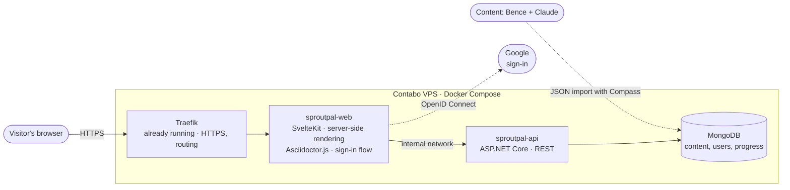
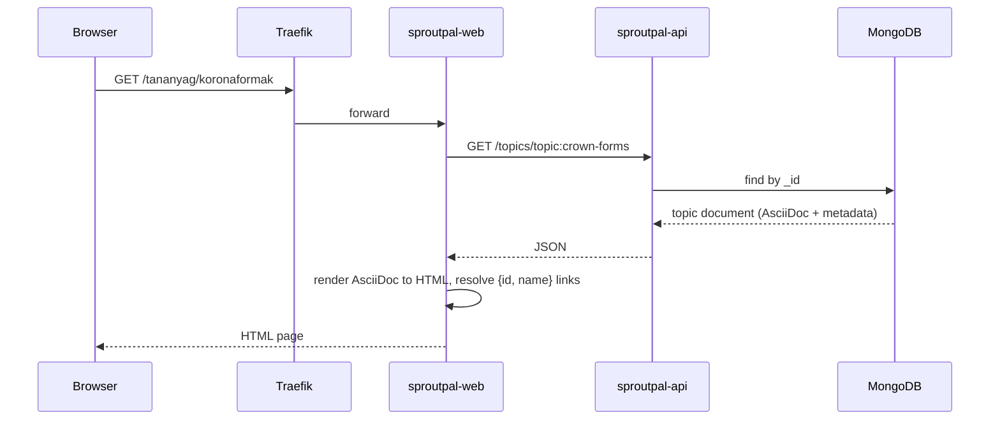
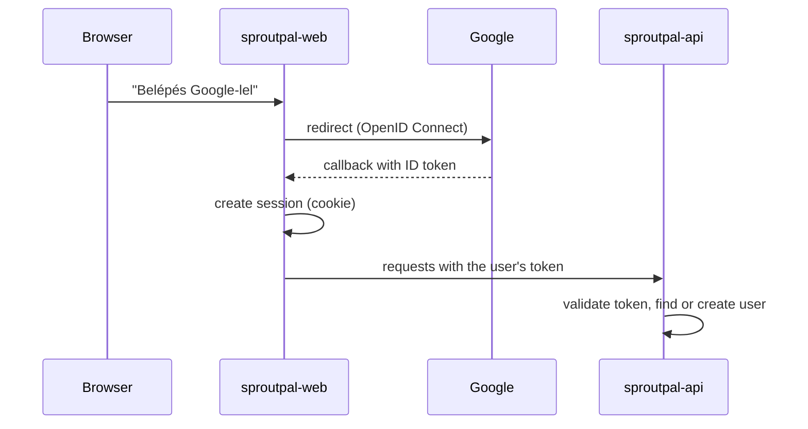
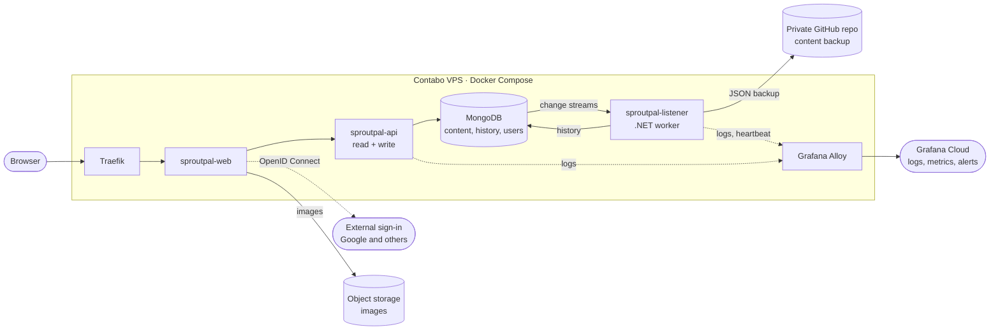

# Architecture overview

- **Status:** Draft
- **Related:** [ADR-0001](decisions/0001-knowledge-base-mongodb.md), [ADR-0002](decisions/0002-content-formats.md), [ADR-0003](decisions/0003-tech-stack.md)

This page shows how SproutPal's parts fit together. The decisions behind them are in the ADRs.

## Demo

The demo is a website with course topics and encyclopedia entries. Visitors can read everything without signing in; signing in with Google saves their course progress. Content is loaded into MongoDB manually.

### Request flow: opening a course topic

### Sign-in flow

### Components

| Component | Repository | Responsibility |
| --- | --- | --- |
| Traefik | already on the VPS | HTTPS certificates, single public entry point, routing to the frontend. The new services attach with Docker labels. |
| Frontend | `sproutpal-web` | Pages, server-side rendering, AsciiDoc rendering, translations of UI texts and enum labels, Google sign-in and session. |
| API | `sproutpal-api` | Access to the knowledge base, users and course progress; token validation; OpenAPI description. The only component that talks to MongoDB. |
| MongoDB | `sproutpal-infra` (configuration) | Course topics, encyclopedia entries, users and their progress. Not reachable from the internet. |
| Content | `sproutpal-content` | Sample content and import files. |

### API (demo)

| Endpoint | Returns |
| --- | --- |
| `GET /topics` | Course topics in course order (titles, ids). |
| `GET /topics/{id}` | One course topic with its AsciiDoc content. |
| `GET /species`, `GET /species/{id}` | Species. |
| `GET /varieties?species={id}`, `GET /varieties/{id}` | Varieties, optionally filtered by species. |
| `GET /rootstocks?species={id}`, `GET /rootstocks/{id}` | Rootstocks. |
| `GET /diseases?species={id}`, `GET /diseases/{id}` | Pests and diseases. |
| `GET /search?q=` | Search across names and synonyms. |
| `GET /me`, `DELETE /me` | The signed-in user; deleting the account and its data. |
| `GET /me/progress`, `PUT /me/progress/{topicId}` | Course progress of the signed-in user. |

Reverse lists (for example the varieties suitable for a rootstock) are served by the API with queries on indexed reference fields ([data model](../02-specs/encyclopedia-data-model.md)).

## Production (later)

When SproutPal goes into production, these parts are added. They are not built for the demo.

| Added part | Purpose | Decision |
| --- | --- | --- |
| More sign-in providers, change notifications | Notify signed-in users when a topic they read has changed. | [concept](../01-product/concept.md) |
| Write path | Content writes through the API, enforcing version and `changeNote`. | ADR-0001 (open point) |
| Listener | Full previous versions into `history`, content backup to GitHub, alerts. | ADR-0001 |
| Object storage | Images for course topics and encyclopedia entries. | ADR-0001 (open point) |
| Monitoring | Grafana Alloy → Grafana Cloud. | ADR-0001, ADR-0003 |

## Deployment

1. A push to a code repository runs its **GitHub Actions** pipeline: build, tests, SonarQube Cloud analysis.
2. A release builds a **Docker image** and pushes it to **GitHub Container Registry**.
3. On the VPS, **Docker Compose** (from `sproutpal-infra`) pulls the new image and restarts the service; Traefik picks up the routing from its labels.
