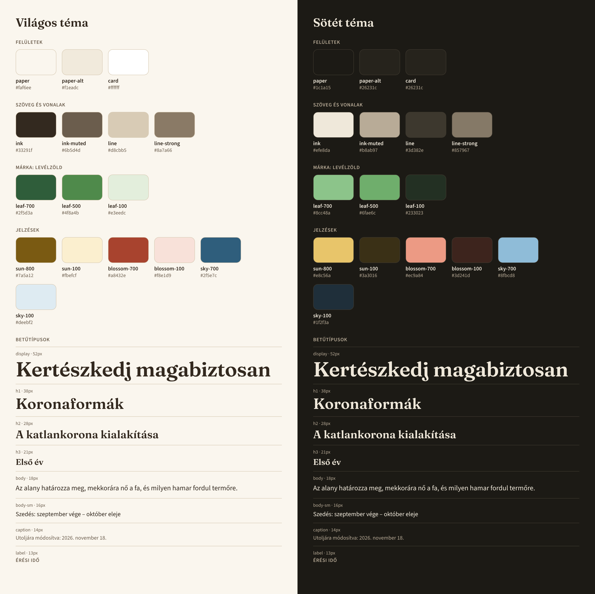
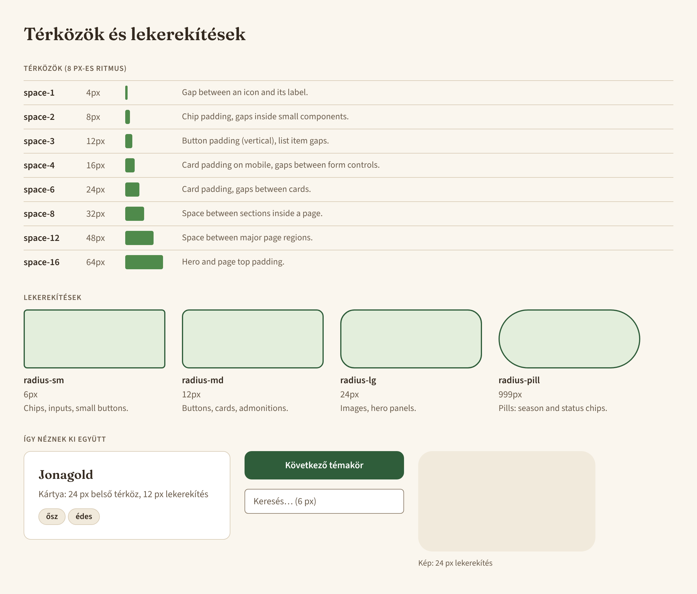
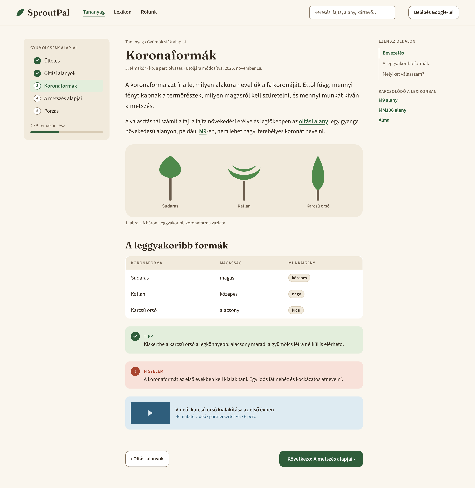
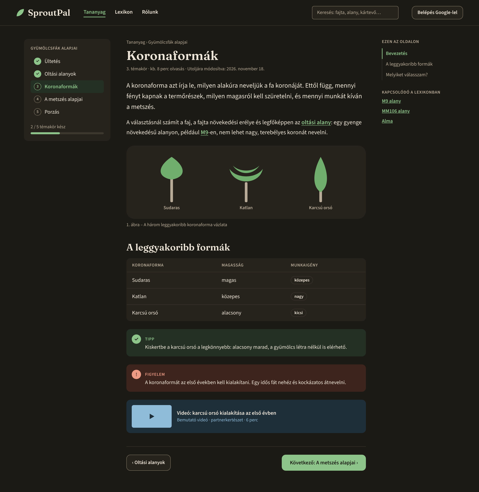

# Design

- **Status:** Foundations approved (2026-11-18); components to be defined.
- **Related:** [ADR-0003](../03-architecture/decisions/0003-tech-stack.md) (plain CSS with custom properties generated from these tokens)

The SproutPal look should feel like a well-made garden book: warm, calm, trustworthy and easy to read for a long time. Natural without being rustic, and never like a shop.

The design tokens are in [`tokens.json`](tokens.json). The website generates CSS custom properties from them (for example `--leaf-700`, `--space-6`, `--radius-md`).

## Principles

1. **Reading comes first.** Most pages are long texts: large body text (18/30 px), lines of 60–75 characters, a warm paper background instead of white.
2. **Connected, not scattered.** References to other entries are always recognizable (green, underlined). A reference whose target is missing is shown as plain text, never as a broken link.
3. **Calm surfaces.** Depth comes from hairlines and soft tints, rarely from shadows.
4. **Nature as colour, not decoration.** Leaf green, ochre, blossom and sky carry meaning (tip, note, warning, info), not ornament.
5. **Data is scannable.** Encyclopedia facts use short labels, values and chips.

## Colours

Two themes, light and dark. Every text colour has at least 4.5:1 contrast on its background in both themes.

| Role | Tokens | Use |
| --- | --- | --- |
| Surfaces | `paper`, `paper-alt`, `card` | Page background, secondary surfaces, cards. |
| Text and lines | `ink`, `ink-muted`, `line`, `line-strong` | Body text, secondary text, hairlines, control borders. |
| Brand: leaf green | `leaf-700`, `leaf-500`, `leaf-100`, `on-leaf` | Links, primary buttons, references; large shapes; tints; text on green. |
| Note | `sun-800`, `sun-100` | Notes, seasonal highlights. |
| Warning | `blossom-700`, `blossom-100` | Warnings, harmful practices, susceptibility. |
| Info | `sky-700`, `sky-100` | Information, external videos. |
| Focus | `focus` | Focus ring around interactive elements. |

## Typography

| Family | Use |
| --- | --- |
| **Fraunces** (serif) | Headings: `display` 52 px, `h1` 38 px, `h2` 28 px, `h3` 21 px. |
| **Source Sans 3** (sans) | Text and UI: `body` 18/30 px, `body-sm` 16 px, `caption` 14 px, `label` 13 px uppercase. |

Both are free Google Fonts with full Hungarian accents (ő, ű).

## Spacing and radius

- **Spacing:** an 8 px rhythm: `space-1` (4 px), `space-2` (8), `space-3` (12), `space-4` (16), `space-6` (24), `space-8` (32), `space-12` (48), `space-16` (64).
- **Radius:** `radius-sm` 6 px (inputs, small elements), `radius-md` 12 px (buttons, cards, admonitions), `radius-lg` 24 px (images), `radius-pill` (chips).

## Sample page

A course topic page using these foundations. The texts and the tree sketches are placeholders.

## Next

Components, one by one: button, admonition, reference, chip, fact panel, entry card.
